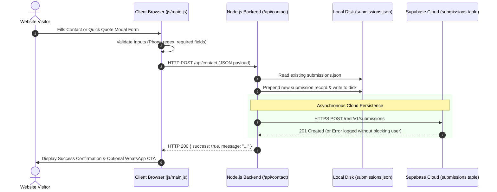
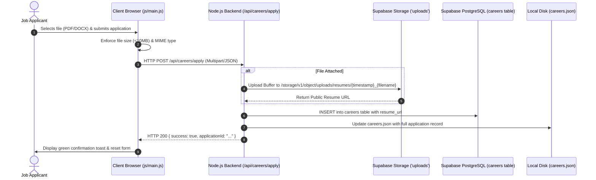

# 02. System Architecture

## 1. Architectural Blueprint

The Sor Connect platform employs a **Hybrid Dual-Tier Decoupled Architecture**. It pairs pre-rendered, high-performance static HTML5 client interfaces with an asynchronous cloud datastore (Supabase PostgreSQL & Object Storage) and a self-healing local failover engine.

```mermaid
flowchart TD
    User([End User Browser])
    Admin([Administrator Browser])
    
    subgraph EdgeLayer ["Edge & Routing Layer (Vercel / Node.js)"]
        Router["Clean URL & 301 Router (vercel.json / server.js)"]
        StaticAssets["Static File Engine (HTML, CSS, JS, Media)"]
        APIProxy["Lightweight API Engine (/api/*)"]
    end

    subgraph DataPlane ["Persistence & Storage Layer"]
        subgraph PrimaryStorage ["Primary Cloud Tier (Supabase)"]
            PostgreSQL[(Supabase PostgreSQL DB)]
            StorageBucket[("Supabase Storage: 'uploads' Bucket")]
        end
        
        subgraph SecondaryStorage ["Secondary Local Tier (Failover)"]
            JSONFiles[("Local JSON Files: submissions, careers, projects, etc.")]
        end
    end

    User -->|1. Request HTML/Assets| Router
    Router --> StaticAssets
    User -->|2. Async Client Fetch (Projects, Services)| PostgreSQL
    User -->|3. Form Submission (Lead/Quote)| APIProxy
    User -->|4. Career Apply with CV| APIProxy
    
    APIProxy -->|Dual Write| PostgreSQL
    APIProxy -->|Dual Write| StorageBucket
    APIProxy -->|Local Backup Write| JSONFiles
    
    Admin -->|Login & Dashboard Access| Router
    Admin -->|CRUD Operations via REST| PostgreSQL
    Admin -->|Fallback Sync| JSONFiles
    
    PostgreSQL -.->|Automated /api/sync| JSONFiles
```

---

## 2. Dual-Tier Storage & Resilience Model

To eliminate the single-point-of-failure risk typical of cloud databases, the system maintains a dual-tier persistence strategy:

1. **Tier 1 (Cloud Primary - Supabase):** 
   - All dynamic content (projects, services, categories, gallery slides, awards, customer leads, and career resumes) lives primarily in Supabase PostgreSQL tables and Storage buckets.
   - Accessed directly by both the client-side browser via PostgREST (`/rest/v1/*`) and the backend `server.js` via HTTPS.
2. **Tier 2 (Local Failover - Flat JSON Storage):**
   - Every entity has a corresponding JSON file in the project root (`projects.json`, `services.json`, `categories.json`, `submissions.json`, `careers.json`, `about_gallery.json`, `awards.json`).
   - If Supabase is unreachable, experiences latency, or returns a 404/500 error, both `js/main.js` and `server.js` automatically fail over to the local JSON file.
   - When administrators invoke the `/api/sync/supabase` endpoint, the system reads all current Supabase tables and refreshes the local JSON snapshots, ensuring local files never become stale.

---

## 3. Data Flow & Sequence Diagrams

### 3.1 Contact Form & Lead Capture Flow



### 3.2 Careers Application & Resume Upload Flow



---

## 4. Client-Side Hydration & Static Fallback Mechanics

The frontend utilizes a **progressive enhancement model**:

1. **Pre-rendered HTML Backbone:** All critical SEO text, initial hero sections, service lists, and project tables are hardcoded inside the HTML files (`index.html`, `services.html`, `projects.html`, `about.html`).
2. **Client-Side Live Hydration (`js/main.js`):**
   - Upon `DOMContentLoaded`, the client issues an asynchronous fetch to `SUPABASE_PROJECTS_URL` and `SUPABASE_CATEGORIES_URL`.
   - If the fetch returns HTTP 200 and an array of objects, the script clears the container and re-renders the cards dynamically using modern semantic HTML templates.
   - If the network request fails, times out, or returns an error, the catch block triggers:
     ```javascript
     catch (err) {
       console.warn('[PROJECTS FETCH WARNING] Could not load live projects from Supabase. Falling back to local data/static HTML...', err);
       // Static verified Supabase HTML fallback remains displayed with zero layout shift
     }
     ```
   - This ensures **zero white-screen errors** under degraded network conditions.

---

## 5. Security Boundaries & Network Architecture

```mermaid
graph LR
    subgraph PublicZone ["Public Network (Untrusted)"]
        PublicUser["Public Web Visitor"]
    end

    subgraph EdgeBoundary ["Edge & DMZ (Vercel / Cloudflare)"]
        CDN["Global Edge CDN & SSL Termination"]
        HeaderSec["Security Headers & Clean URL Engine"]
    end

    subgraph ComputeZone ["Application Server"]
        NodeApp["Node.js Application (server.js)"]
        AdminPortal["Admin Console (/admprtl)"]
    end

    subgraph DataZone ["Protected Data Perimeter"]
        SupaPostgres[("Supabase DB (RLS Protected)")]
        SupaBuckets[("Supabase Storage ('uploads')")]
        LocalFiles[("Local JSON Files (Internal Disk)")]
    end

    PublicUser -->|HTTPS :443| CDN
    CDN --> HeaderSec
    HeaderSec --> NodeApp
    
    NodeApp -->|API Key (Anon with RLS)| SupaPostgres
    NodeApp -->|API Key| SupaBuckets
    NodeApp -->|File System IO| LocalFiles
    
    AdminPortal -.->|Token Authentication| NodeApp
```

### Security Isolation Layers:
- **Client-to-Database:** Client browsers never receive service-role database keys. All direct client queries use the public `anon` JWT key, strictly limited by PostgreSQL Row-Level Security policies.
- **Admin Interface:** The admin interface (`/admprtl`) is decoupled from the main website bundle and requires token-based authentication verified against internal server checks before executing administrative write operations.
