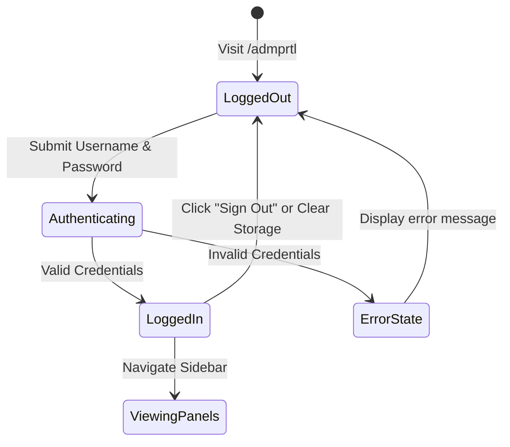

# 06. CMS & Administrator Operations Manual

## 1. Accessing the Admin Management Console

- **Access URL:** Navigate to `https://www.sorconnect.in/admprtl` in any modern web browser.
- **Alternative URL:** `https://www.sorconnect.in/admprtl.html`
- **Security Notice:** The Admin Portal is intentionally excluded from search engines using `<meta name="robots" content="noindex, nofollow">` and is blocked in `robots.txt`.

---

## 2. Authentication & Session Management

1. **Login Credentials:**
   - **Authorized Usernames:** `admin`, `sorconnect`, `sorconnectadmin`, `info@sorconnect.com`
   - **Authorized Passwords:** Configured in `server.js` (managed by system administrator).
2. **Session Persistence:**
   - Upon successful verification, an authorization token (`sorconnect_auth_token_*`) and user profile are securely stored in your browser's `localStorage`.
   - You will remain signed in across browser tabs until you explicitly click the **Sign Out** button at the bottom of the sidebar.
3. **Session Termination:**
   - Clicking **Sign Out** purges `localStorage` and immediately returns the screen to the secure login prompt.

---

## 3. Dashboard Navigation & Layout Overview

The administrative console is divided into three functional zones:
- **Left Sidebar:** Displays the Sor Connect logo, Supabase Live connection status, navigation grouped under **Lead Management**, **Website CMS**, and **Media & Proof**, plus quick actions ("Sync Supabase", "View Live Site", "Sign Out").
- **Top Header Bar:** Displays the current active section title, explanatory subtitle, and primary action buttons (e.g. `+ Add Project`, `+ Add Slide`).
- **Main Working Area:** High-density, searchable data tables equipped with instant search filters, status badges, edit modals, and delete confirmations.

---

## 4. Module-by-Module Operational Guides

---

### Module 1: Form Submissions (Customer Leads)
*Manage incoming solar inquiries generated from the homepage, contact page, and quick quote modals.*

1. **Viewing Leads:** Click **Form Submissions** in the sidebar. Leads are displayed chronologically with the newest submissions at the top.
2. **Reviewing Inquiry Details:** Each row displays:
   - **Customer Name & Date:** Timestamp of submission.
   - **WhatsApp / Phone Number:** Direct one-click link to initiate a WhatsApp chat or phone call.
   - **Monthly Electricity Bill:** Stated electricity expenditure (e.g. `₹50,000+ / month`).
   - **Pincode & Location:** Customer's installation location.
   - **Status Badge:** Visual indicator of lead stage.
3. **Updating Lead Status:**
   - Click the status dropdown menu on any lead.
   - Choose from: `New` (Blue), `Contacted` (Yellow), `In Progress` (Purple), `Closed / Won` (Green), or `Junk` (Gray).
   - The status saves immediately to both the Supabase cloud database and the local server.
4. **Deleting a Submission:**
   - Click the red **Trash Can** icon on the right side of the row.
   - Confirm the browser prompt. The lead will be permanently removed.

---

### Module 2: Job Applications (Careers Recruitment)
*Review candidate applications submitted through the global Careers modal.*

1. **Navigating Applications:** Click **Job Applications** in the sidebar.
2. **Reviewing Candidates:**
   - **Candidate Name & Contact:** Email, phone, and current city.
   - **Position Applied For:** Target engineering or sales role (e.g. `Solar Design & PVsyst Engineer`).
   - **Experience & Availability:** Stated years in solar and notice period.
   - **Attached Resume:** Click **Download CV** to view or save the candidate's PDF/DOC resume uploaded to Supabase Storage.
3. **Updating Application Status:**
   - Select `New`, `Reviewing`, `Interview Scheduled`, `Selected`, or `Archived` to track the candidate's hiring progress.

---

### Module 3: Projects Portfolio
*Add, update, or remove completed solar installations featured on `/projects` and the homepage.*

1. **Adding a New Project:**
   - Click the green **`+ Add Project`** button in the top right.
   - **Project Title:** Descriptive name (e.g. `1.2 MW Industrial Ground Mount`).
   - **Client / Facility:** Name of industrial company or DISCOM.
   - **Category:** Select from the dropdown (e.g. `Commercial Rooftop`, `Turnkey EPC`, `O&M`).
   - **Capacity:** Rated power (e.g. `1200 kW` or `1.2 MW`).
   - **Location:** City, State (e.g. `Sitapura Industrial Area, Jaipur`).
   - **Project Image:** Click **Upload Image** to select a photo from your computer (automatically uploaded to Supabase Storage) or paste an image URL.
   - Click **Save Project**.
2. **Editing an Existing Project:**
   - Locate the project in the table and click **Edit**.
   - Adjust the fields in the modal and click **Update Project**.
3. **Deleting a Project:**
   - Click the **Delete** button and confirm. The project is immediately removed from the live website portfolio.

---

### Module 4: Project Categories
*Organize your portfolio into logical industry sectors.*

- **Default Categories:** `Turnkey EPC`, `Commercial Rooftop`, `I&C / O&M`, `PM-KUSUM`.
- **Adding a Category:** Click **`+ Add Category`**, enter a category name (e.g. `Floating Solar`), slug (`floating-solar`), and optional description.
- > [!WARNING]
  > Deleting a category that currently has active projects linked to it will orphan those projects in category filters. Reassign projects before deleting a category.

---

### Module 5: Services Page CMS
*Manage the detailed service offerings presented on `/services`.*

- **Fields Available:** Service Title, Short Summary, Detailed Description, Feature Bullet Points, and Associated Image.
- **Reordering Services:** Adjust the numeric **Display Order** field to move services up or down on the public page.

---

### Module 6: Strategic Partners & Alliances
*Control the technology partner logos (Sungrow, Reliance, Waree, etc.) displayed across the website.*

- **Adding a Partner:** Enter the partner name, upload their transparent PNG logo, and select the relationship tier (e.g. `Tier-1 Inverter Partner`, `Solar PV Module Partner`).

---

### Module 7: About Us Carousel (Media & Proof)
*Manage the photographic slider on the `/about` page highlighting field installations.*

1. Click **About Us Carousel** under the **Media & Proof** sidebar section.
2. Click **`+ Add Carousel Slide`**.
3. Fill in:
   - **Slide Title:** (e.g. `High-Efficiency Ground Mount Substation`).
   - **Subtitle / Capacity:** (e.g. `5 MW High-Tension Grid Integration`).
   - **Badge:** (e.g. `Utility Scale` or `Field Showcase`).
   - **Location:** (e.g. `Bikaner, Rajasthan`).
   - **Image:** Upload a high-resolution landscape photo (16:9 ratio recommended).
   - **Display Order:** Numeric sequence (1, 2, 3...).
4. Click **Save Slide**.

---

### Module 8: Awards & Recognitions
*Manage company certifications, government recognitions, and green energy awards.*

- Enter the award title, conferring body (e.g. `Bharat Renewable Leadership`), year, badge, and photo of the certificate/trophy.

---

## 5. Media & Image Upload Best Practices

- **Recommended Image Formats:** WebP or JPG for photographs; transparent PNG or SVG for logos.
- **Maximum File Size:** 10 MB per upload (enforced by the server and Supabase Storage).
- **Aspect Ratios:**
  - **Project Cards:** 16:9 or 4:3 landscape.
  - **About Us Carousel:** 16:9 landscape (minimum `1200x675px`).
  - **Partner Logos:** Square or transparent horizontal strip (`400x150px`).
  - **Awards:** 4:3 or 1:1 square.

---

## 6. Critical Safety Rules for Administrators

> [!CAUTION]
> 1. **Deletions are Permanent:** When you delete a lead, project, or application in the Admin Portal, it is purged from the database. Always export or confirm before deleting.
> 2. **Never Edit `admprtl.html` Directly in Code:** If technical changes are needed to the admin panel, developers must edit `admin_client.js`, `admin_templates.js`, or `admin_styles.js` and run `node build_admprtl.js`. Directly modifying `admprtl.html` will be overwritten during future builds.
> 3. **Avoid Special Characters in Image Filenames:** Name images cleanly (e.g. `jaipur-rooftop-1mw.jpg`) rather than using symbols, spaces, or emojis.
