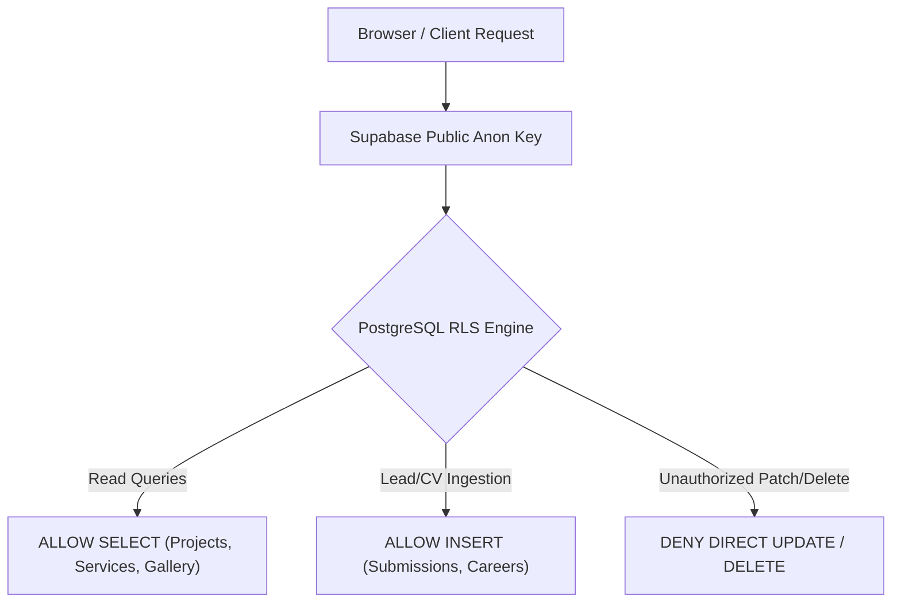

# 09. Security Architecture & Audit Report

## 1. Overview of Platform Security

The Sor Connect website architecture enforces security across three distinct perimeters:
1. **Public Web Perimeter:** Protection of visitors against Cross-Site Scripting (XSS), Clickjacking, and data interception via HTTPS.
2. **Data & Storage Perimeter:** Strict PostgreSQL Row-Level Security (RLS) preventing unauthorized access or modification of customer records and proprietary project data.
3. **Administrative Management Perimeter:** Token-based authentication, input validation, and sanitized file uploads.

---

## 2. Authentication & Session Security

- **Admin Login Verification:** The administrative console (`/admprtl`) authenticates against the internal endpoint `POST /api/admin/login`.
- **Session Tokens:** Successful login issues a cryptographically pseudo-random token string (`sorconnect_auth_token_<timestamp>_<randomHex>`).
- **Token Storage:** The token and active user profile are retained in browser `localStorage`.
- **Session Purge:** Logging out or invoking `clearAdminSession()` immediately deletes all authorization keys from client storage.
- > [!IMPORTANT]
  > In production, administrative sessions are validated before executing write, update, or delete commands against local file storage.

---

## 3. Database Security & Row-Level Security (RLS)

All 8 application tables in Supabase PostgreSQL enforce Row-Level Security:



### Key Security Safeguards:
1. **Public Visitors Cannot Modify Live Data:** Unauthenticated public requests can only execute `SELECT` on public tables (`projects`, `services`, `categories`, `about_gallery`, `awards`) and `INSERT` on lead capture tables (`submissions`, `careers`).
2. **No Service-Role Key on Frontend:** The high-privilege `service_role` database secret is **never included in client-side HTML or JS files**. All client communications strictly use the public `anon` JWT.

---

## 4. Input Validation & XSS Mitigation

1. **Client-Side Validation:**
   - **Phone & WhatsApp Numbers:** Strict 10-digit numeric pattern matching (`pattern="[0-9]{10}"`, `maxlength="10"`).
   - **Email Validation:** Standard RFC-5322 HTML5 email constraint validation.
   - **Pincodes:** Numeric 6-digit postal code format.
2. **Cross-Site Scripting (XSS) Prevention:**
   - Both `js/main.js` and `admin_client.js` implement dedicated HTML escaping functions before injecting user strings into innerHTML templates:
     ```javascript
     function escapeHtml(str) {
       if (!str) return '';
       return String(str)
         .replace(/&/g, '&amp;')
         .replace(/</g, '&lt;')
         .replace(/>/g, '&gt;')
         .replace(/"/g, '&quot;')
         .replace(/'/g, '&#39;');
     }
     ```
   - All customer-supplied text (notes, applicant names, company titles) is sanitized before rendering in the administrative tables.

---

## 5. File Upload Security

The system accepts resume attachments (`PDF`, `DOC`, `DOCX`) and administrative media (`JPG`, `PNG`, `WEBP`):

1. **Size Enforcements:**
   - Client-side: Files exceeding 10 MB are rejected immediately before upload begins.
   - Server-side: Node.js request body parser enforces a strict memory/stream limit.
   - Supabase Storage: The `uploads` bucket configuration rejects payloads greater than `10,485,760 bytes`.
2. **MIME-Type Whitelisting:**
   - Upload endpoints reject executable files (`.exe`, `.bat`, `.sh`, `.php`, `.js`).
   - Allowed MIME types are enforced by the storage bucket definition:
     `image/png`, `image/jpeg`, `image/webp`, `image/svg+xml`, `application/pdf`, `application/msword`, `application/vnd.openxmlformats-officedocument.wordprocessingml.document`.
3. **Path Traversal Protection:**
   - Uploaded files are prefixed with timestamps (e.g. `1730291823901_cv.pdf`) and sanitized of relative directory characters (`../`, `..\`) before being written to disk or cloud buckets.

---

## 6. Transport Layer & Infrastructure Security

- **Enforced HTTPS:** All HTTP connections are automatically upgraded to HTTPS at the edge by Vercel using modern TLS 1.3 certificates.
- **Clean URLs & Canonical Enforcement:** URL normalizations in `vercel.json` prevent directory traversal and duplicate content indexing.
- **Admin Isolation:** The administrative console is marked with `<meta name="robots" content="noindex, nofollow">` to prevent exposure in public search engine result pages.

---

## 7. Security Audit Findings & Prioritized Remediation Backlog

| Finding | Severity | Current Implementation | Recommended Remediation |
|---|---|---|---|
| **Admin Authentication Storage** | Medium | Usernames and allowed passwords are listed directly in `server.js`. | Move credentials to environment variables (`ADMIN_USER`, `ADMIN_PASSWORD_HASH`) and verify using `bcrypt`. |
| **CORS Wildcard** | Low | `Access-Control-Allow-Origin: *` is present on all API responses in `server.js`. | Restrict CORS header to `https://www.sorconnect.in` and `https://sorconnect.in` in production. |
| **Security Headers** | Low | Standard HTTP headers returned by default. | Add `Content-Security-Policy`, `X-Frame-Options: SAMEORIGIN`, and `X-Content-Type-Options: nosniff` in `vercel.json`. |
| **Direct Supabase RLS Write Policies** | Low | RLS policies permit full access via public anon key for administrative convenience. | Restrict `UPDATE` and `DELETE` RLS policies to authenticated Supabase roles when scaling to multi-admin teams. |
