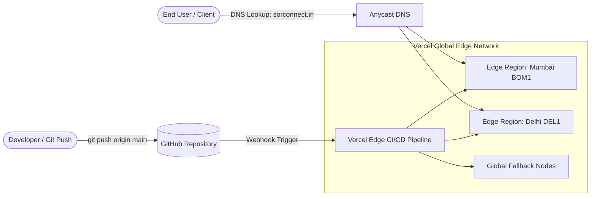

# 10. Hosting, Deployment & Infrastructure Guide

## 1. Primary Hosting Architecture: Vercel Edge Platform

The Sor Connect website is hosted on **Vercel's Global Edge Network**, providing sub-second edge routing, automated SSL certificate generation, and continuous CI/CD deployment linked to the project's GitHub repository.



---

## 2. Domain & DNS Configuration

- **Primary Canonical Domain:** `https://www.sorconnect.in`
- **Secondary Apex Domain:** `https://sorconnect.in` (301 redirects to `www`)
- **DNS Host / Registrar:** Hostinger / GoDaddy / Cloudflare

### Required DNS Records:
| Type | Name / Host | Target Value | TTL | Purpose |
|---|---|---|---|---|
| **A** | `@` (Apex) | `76.76.21.21` | Auto / 3600 | Points root domain `sorconnect.in` to Vercel edge |
| **CNAME** | `www` | `cname.vercel-dns.com` | Auto / 3600 | Points canonical `www.sorconnect.in` to Vercel edge |
| **TXT** | `_vercel` | `<VERCEL_VERIFICATION_TOKEN>` | Auto | Proves domain ownership to Vercel |

---

## 3. Edge Routing & Clean URLs (`vercel.json`)

Vercel edge behavior is controlled by the root `vercel.json` file:

```json
{
  "cleanUrls": true,
  "trailingSlash": false,
  "redirects": [
    { "source": "/home", "destination": "/", "permanent": true },
    { "source": "/index.html", "destination": "/", "permanent": true }
  ]
}
```

### Routing Rules Explained:
1. **`cleanUrls: true`:** Automatically maps clean directory paths to static HTML files. For example:
   - Visiting `/about` automatically serves `about.html` without showing `.html` in the browser address bar.
   - Visiting `/services` automatically serves `services.html`.
2. **`trailingSlash: false`:** Strips accidental trailing slashes (e.g. `/projects/` redirects to `/projects`), preventing duplicate content penalties in Google Search.
3. **Permanent 301 Redirects:** Consolidates all legacy or manual requests for `/home` and `/index.html` to the authoritative root `/`, concentrating search engine domain authority.

---

## 4. Build & Compilation Pipelines

### 4.1 Admin Portal Compilation
The administrative dashboard (`admprtl.html`) is compiled using the internal Node.js builder:
```bash
# Execute compilation
node build_admprtl.js
```
- **Builder Mechanics:** Reads `admin_templates.js` (HTML structures), `admin_client.js` (logic & state), and `admin_styles.js` (CSS tokens), then writes a single production file `admprtl.html`.
- **When to Run:** Whenever changes are made to the admin interface source code.

### 4.2 Local Development Server
To launch the complete application stack locally with the full Node.js API engine:
```bash
# Start local server on port 3000 (or custom PORT env variable)
node server.js
```
- The local server provides full API mockups, dual-tier syncing, local JSON file read/writes, and file serving at `http://localhost:3000`.

---

## 5. Alternative Standalone Node.js Deployment (VPS / Ubuntu / PM2)

If the client chooses to host the website on a dedicated Virtual Private Server (e.g. AWS EC2, DigitalOcean Droplet, Hostinger VPS) instead of Vercel:

### 5.1 Prerequisites
```bash
# Install Node.js 18+ and PM2 Process Manager
sudo apt update && sudo apt install -y nodejs npm
sudo npm install -g pm2
```

### 5.2 Launch with PM2
```bash
# Clone repository and enter directory
git clone https://github.com/coded-dhruv/sorconnect.git
cd sorconnect

# Install dependencies
npm install

# Start production cluster daemon
pm2 start server.js --name "sorconnect" -i max

# Configure auto-restart on system reboot
pm2 startup
pm2 save
```

### 5.3 Nginx Reverse Proxy Configuration (`/etc/nginx/sites-available/sorconnect`)
```nginx
server {
    server_name www.sorconnect.in sorconnect.in;

    location / {
        proxy_pass http://127.0.0.1:3000;
        proxy_http_version 1.1;
        proxy_set_header Upgrade $http_upgrade;
        proxy_set_header Connection 'upgrade';
        proxy_set_header Host $host;
        proxy_cache_bypass $http_upgrade;
        proxy_set_header X-Forwarded-For $proxy_add_x_forwarded_for;
        proxy_set_header X-Forwarded-Proto $scheme;
    }
}
```

---

## 6. Rollback & Disaster Recovery Procedures

1. **Instant Vercel Rollback:**
   - Log into the **Vercel Dashboard** &rarr; select project **`sorconnect`** &rarr; navigate to **Deployments**.
   - Locate the previous stable deployment &rarr; click the three dots (`...`) &rarr; select **"Instant Rollback"**.
   - Vercel updates edge DNS pointers within **3 seconds** without requiring a new git build.
2. **Git Rollback:**
   ```bash
   # Revert to previous stable commit and force-push to main
   git revert HEAD
   git push origin main
   ```
