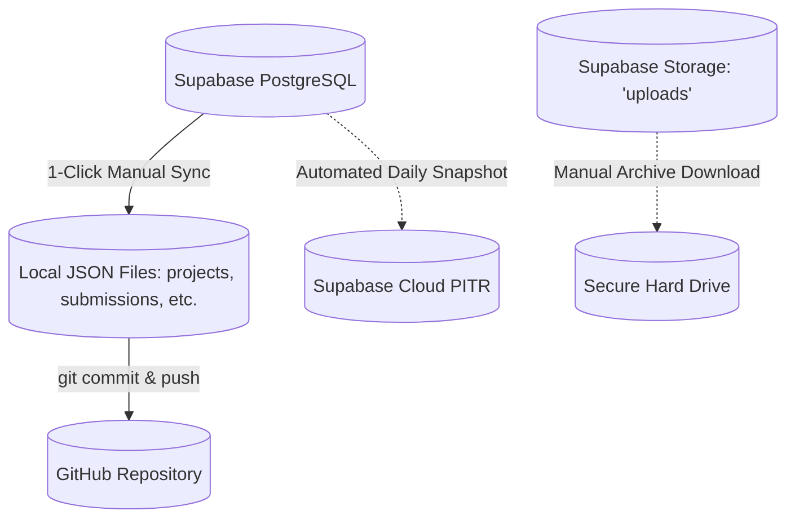

# 13. Ongoing Maintenance & Operations Manual

## 1. Routine Maintenance Schedule

To guarantee 99.9% uptime, zero lead loss, and peak search visibility, operational tasks should be executed according to the following cadence:

| Frequency | Task Description | Target System / Tool | Estimated Time |
|---|---|---|---|
| **Daily / Weekly** | Review new customer inquiries and assign sales follow-ups. | Admin Portal (`/admprtl` &rarr; Form Submissions) | 10 mins |
| **Weekly** | Review incoming job applications and download candidate CVs. | Admin Portal (`/admprtl` &rarr; Job Applications) | 15 mins |
| **Monthly** | Trigger a full cloud-to-local database sync. | Admin Portal &rarr; Click **"Sync Supabase"** | 2 mins |
| **Monthly** | Inspect Google Search Console for crawl anomalies or unindexed URLs. | Google Search Console (`sorconnect.in`) | 15 mins |
| **Monthly** | Test all lead capture forms (Contact page, Quick Quote modal, Careers form). | Web Browser (Desktop + Mobile) | 10 mins |
| **Quarterly** | Audit npm dependencies and check for security advisories. | Terminal (`npm audit`) | 30 mins |
| **Quarterly** | Inspect Supabase Storage bucket capacity and delete rejected applicant CVs. | Supabase Dashboard &rarr; Storage (`uploads`) | 20 mins |

---

## 2. Backup & Disaster Recovery Protocols

The platform maintains a **triple-redundant backup architecture**:



### 2.1 Automated Cloud Backups (Supabase)
- **Point-in-Time Recovery (PITR):** Supabase automatically snapshots the entire database on a continuous basis.
- **Restoration:** If data is accidentally deleted or corrupted, log into the Supabase dashboard &rarr; **Database** &rarr; **Backups** &rarr; select the desired restore point and click **Restore**.

### 2.2 Local JSON Snapshots
- The root JSON files (`submissions.json`, `careers.json`, `projects.json`, `services.json`, `partners.json`, `about_gallery.json`, `awards.json`) serve as immediate human-readable backups.
- Running `/api/sync/supabase` pulls the latest records from the cloud and overwrites these files with fresh data.
- Committing these JSON files to your GitHub repository provides an immutable, version-controlled audit trail.

### 2.3 Manual Database Export via `pg_dump`
To create a local standalone `.sql` backup file of the entire database:
```bash
# Export schema and all table data into a compressed SQL dump
pg_dump -h db.znjpzipedsowuyrpotgb.supabase.co -U postgres -d postgres -F c -b -v -f sorconnect_backup_$(date +%F).dump
```

---

## 3. Storage Bucket Hygiene & Management

As candidate applications accumulate, resume PDFs and high-resolution project photos will consume storage space in the `uploads` bucket:

1. **Purging Old Candidate CVs:**
   - Resumes older than 180 days should be downloaded to local HR archives and deleted from the Supabase `uploads/resumes/` bucket to conserve storage and respect privacy standards.
2. **Deleting Unused Media:**
   - When a project photo or partner logo is replaced in the Admin Portal, remember to delete the orphaned image file from the Supabase Storage dashboard to prevent storage clutter.

---

## 4. Safe Procedure for Updating Website Content

When content changes are requested by management:

1. **If the content is managed by CMS (Projects, Services, Partners, Carousel, Awards):**
   - **Do NOT edit HTML files.**
   - Log into `/admprtl` and update the content through the web interface.
   - The changes will publish instantly across the site.
2. **If the content is hardcoded (Homepage headline, office address, phone number):**
   - Open the target HTML file (e.g. `index.html` or `contact.html`).
   - Locate the text string and update it cleanly.
   - Test locally using `node server.js`.
   - Commit and push to GitHub:
     ```bash
     git add .
     git commit -m "chore(content): update contact phone number"
     git push origin main
     ```
   - Vercel will automatically deploy the updated page within seconds.
