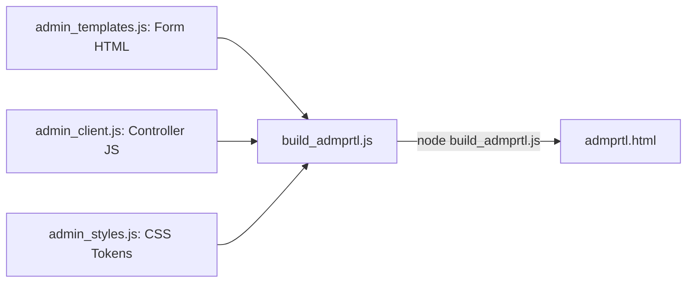

# 14. Developer Onboarding & Development Guide

## 1. Prerequisites & Environment Setup

Welcome to the Sor Connect engineering team. Before working on the codebase, ensure your local development workstation meets the following requirements:

- **Node.js:** Version `18.16.0` LTS or higher (Node `20.x` recommended).
- **npm:** Version `9.x` or higher.
- **Git:** Version `2.38+`.
- **Recommended IDE:** Visual Studio Code with the following extensions:
  - *Prettier - Code Formatter*
  - *Live Server* (optional, though `node server.js` is preferred)
  - *PostgreSQL* extension (for direct database exploration)

---

## 2. Quickstart: Cloning & Running Locally

```bash
# 1. Clone the repository from GitHub
git clone https://github.com/coded-dhruv/sorconnect.git
cd sorconnect

# 2. Install dependencies
npm install

# 3. Launch the full local HTTP/HTTPS application server
node server.js
```

Once running, access the local environments:
- **Public Website:** `http://localhost:3000/`
- **Admin Management Portal:** `http://localhost:3000/admprtl`
- **Services Page:** `http://localhost:3000/services`
- **Projects Portfolio:** `http://localhost:3000/projects`

---

## 3. Modifying the Admin Portal (Crucial Architecture Rule)

> [!WARNING]
> **NEVER EDIT `admprtl.html` DIRECTLY.**
> `admprtl.html` is a compiled production artifact. If you edit it directly, your changes will be completely erased the next time `build_admprtl.js` is executed.

### Correct Workflow for Admin Portal Modifications:


1. **To modify form layouts, panels, or modals:** Edit `admin_templates.js`.
2. **To modify client logic, REST queries, or table rendering:** Edit `admin_client.js`.
3. **To modify admin colors, fonts, or sidebar geometries:** Edit `admin_styles.js`.
4. **Recompile the admin file:**
   ```bash
   node build_admprtl.js
   ```
5. **Verify:** Open `http://localhost:3000/admprtl` in your browser and hard-refresh (`Ctrl + F5`).

---

## 4. Frontend Development Conventions

### 4.1 Modifying Styles (`css/style.css`)
- **Use CSS Variables:** Always reference established design tokens (`var(--forest)`, `var(--leaf)`, `var(--heading)`) instead of hardcoding random hex values.
- **No Third-Party CSS Frameworks:** Do not inject Bootstrap, Tailwind, or Bulma into public HTML files. The design system relies on clean, modular vanilla CSS to maintain sub-second load times.
- **Responsive-First:** Always verify changes on both wide monitors (`1920px`) and mobile handsets (`375px`).

### 4.2 Modifying Client Interactivity (`js/main.js`)
- **Vanilla DOM API:** Use standard `document.querySelector` and `addEventListener`. Avoid jQuery.
- **Sanitize Dynamic Strings:** Always wrap user-supplied or API-returned strings with `escapeHtml(...)` before concatenating into `.innerHTML`.
- **Preserve Fallbacks:** When querying Supabase REST endpoints, always retain the `try / catch` structure with static HTML fallback handling so a database hiccup never results in a broken UI.

---

## 5. Git Branching & Deployment Workflow

1. **Branching Model:**
   - `main`: Production branch. Every push to `main` immediately triggers a live production deployment on Vercel.
   - `feature/<feature-name>`: Development branches for new features or significant refactoring.
2. **Commit Message Format:**
   Use Conventional Commits:
   - `feat(projects): add multi-tag filtering to portfolio`
   - `fix(contact): correct phone validation regex for 10 digits`
   - `style(about): adjust carousel transition speed`
   - `docs(readme): update developer onboarding guide`
3. **Deploying Changes to Live:**
   ```bash
   # Ensure all changes are tested locally
   git status
   git add -A
   git commit -m "feat(seo): optimize service page schema"
   git push origin main
   ```
   Monitor the deployment in the [Vercel Dashboard](https://vercel.com).
