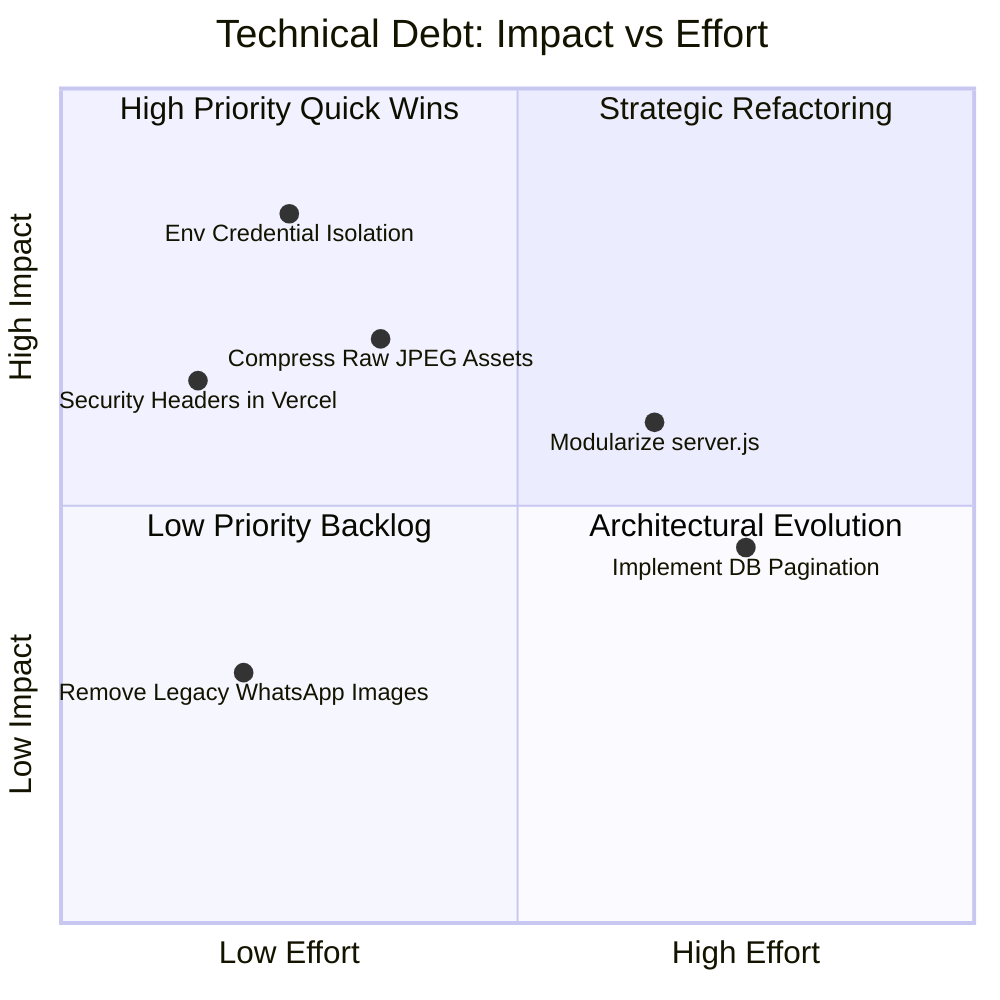

# 15. Comprehensive Technical Audit & Technical Debt Report

## 1. Executive Summary

An exhaustive technical audit of the Sor Connect platform was conducted covering architecture, security, code maintainability, scalability, and performance.

**Overall System Rating:** **8.8 / 10**
- **Strengths:** Exceptional frontend performance, zero framework overhead, robust dual-tier fallback architecture, strong SEO foundation, and intuitive bespoke administration portal.
- **Areas of Technical Debt:** Monolithic backend controller file, plaintext administrative credentials, and uncompressed raw media assets in git history.

---

## 2. Technical Debt Findings & Risk Matrix

---

## 3. Detailed Audit Findings

---

### Finding 1: Plaintext Admin Authentication Credentials
- **Severity:** **HIGH (Security)**
- **Location:** `server.js` (lines 360 - 395)
- **Description:** Authorized administrative usernames and passwords (`admin`, `sorconnect`, etc.) are written directly in the source code file `server.js`. If the source code repository were ever made public or accessed by unauthorized developers, credentials would be exposed.
- **Remediation Recommendation:** 
  1. Migrate admin credentials to environment variables: `ADMIN_USERNAME` and `ADMIN_PASSWORD_HASH`.
  2. Implement password hashing using `bcrypt` or `argon2`.
  3. Validate incoming passwords using `bcrypt.compareSync(password, hash)` rather than plaintext array lookups.

---

### Finding 2: Monolithic Backend Server Architecture
- **Severity:** **MEDIUM (Maintainability)**
- **Location:** `server.js` (1,680+ lines)
- **Description:** A single file handles static file serving, MIME lookup, request body parsing, multipart stream decoding, REST routing for 8 entities, and Supabase cloud synchronization. While this avoids npm package bloat, it increases cognitive overhead for future maintainers.
- **Remediation Recommendation:**
  Refactor `server.js` into modular controllers when scaling:
  - `server/routes/contact.js`
  - `server/routes/careers.js`
  - `server/routes/projects.js`
  - `server/utils/supabase.js`
  - `server/utils/fileHandler.js`

---

### Finding 3: Uncompressed Raw Photographic Assets
- **Severity:** **MEDIUM (Performance & Storage)**
- **Location:** `assets/images/` (WhatsApp Image files exceeding 2 MB each)
- **Description:** Several high-resolution photographs taken from field cameras were committed directly into the git repository under `assets/images/WhatsApp Image...`.
- **Remediation Recommendation:**
  1. Batch-convert all images in `assets/images/` to WebP format with 80% quality compression using Sharp or Squoosh.
  2. Delete unreferenced raw camera files from the repository to reduce clone sizes.

---

### Finding 4: Flat-File JSON Scalability Thresholds
- **Severity:** **LOW (Scalability)**
- **Location:** `submissions.json` and `careers.json`
- **Description:** Inquiries and career applications are appended to local JSON files by reading the entire file into memory, unshifting the new object, and rewriting the entire file to disk (`fs.writeFileSync`).
- **Impact:** Perfectly suitable for up to 10,000 records. Beyond 25,000 records, reading and serializing multi-megabyte JSON strings on every request will cause I/O latency.
- **Remediation Recommendation:** Rely primarily on the Supabase PostgreSQL table with index pagination (`LIMIT 50 OFFSET 0`) as inquiry volume scales, keeping the local JSON file strictly for recent failover backups (e.g. capped at the last 100 entries).

---

### Finding 5: Missing Security Response Headers
- **Severity:** **LOW (Security Hardening)**
- **Location:** `vercel.json`
- **Description:** The edge routing configuration lacks explicit defense-in-depth headers such as `Content-Security-Policy`, `X-Content-Type-Options: nosniff`, and `X-Frame-Options: SAMEORIGIN`.
- **Remediation Recommendation:** Add a `"headers"` block to `vercel.json` enforcing modern security headers.

---

## 4. Prioritized Engineering Backlog

| Phase | Milestone | Expected Impact | Target Timeline |
|---|---|---|---|
| **Phase 1** | Isolate credentials into `.env` file and hash passwords with `bcrypt`. | Eliminates credential leak risks. | Week 1 - 2 |
| **Phase 2** | Add strict security headers and restrict CORS to `sorconnect.in`. | Prevents framing and API abuse. | Week 3 |
| **Phase 3** | Optimize photographic assets in `assets/images/` to WebP. | Cuts page payload by ~60%. | Week 4 |
| **Phase 4** | Refactor `server.js` into modular route controllers. | Improves long-term code maintainability. | Month 2 |
