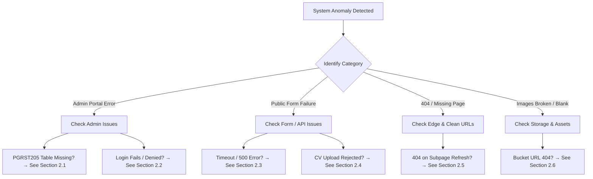

# 17. Operational Troubleshooting & Diagnostics Runbook

## 1. Quick Diagnostic Decision Tree



---

## 2. Common Scenarios, Root Causes & Resolutions

---

### 2.1 Scenario: "Supabase 404 PGRST205 - Could not find table 'public.carousel_slides'"

#### Symptoms:
- In the Admin Portal under **Media & Proof &rarr; About Us Carousel**, the table fails to load and displays:  
  `Supabase 404: {"code":"PGRST205","message":"Could not find the table 'public.carousel_slides' in the schema cache"}`

#### Root Cause:
1. The PostgreSQL database table for the About Us plant slider is named **`about_gallery`** (matching `about_gallery.json` and `schema.sql`), but an earlier cached version of the admin script requested `/rest/v1/carousel_slides`.
2. Or the table has not yet been executed in your Supabase project.

#### Resolution:
1. Open **Supabase Dashboard** &rarr; **SQL Editor** &rarr; run the following script:
   ```sql
   CREATE TABLE IF NOT EXISTS public.about_gallery (
       id BIGINT GENERATED BY DEFAULT AS IDENTITY PRIMARY KEY,
       title TEXT NOT NULL,
       subtitle TEXT,
       badge TEXT DEFAULT 'Field Showcase',
       description TEXT,
       location TEXT,
       image TEXT NOT NULL,
       display_order INT DEFAULT 1,
       created_at TIMESTAMPTZ DEFAULT TIMEZONE('utc'::text, NOW()) NOT NULL
   );
   ALTER TABLE public.about_gallery ENABLE ROW LEVEL SECURITY;
   CREATE POLICY "Public can view gallery" ON public.about_gallery FOR SELECT USING (true);
   CREATE POLICY "Full access to gallery" ON public.about_gallery FOR ALL USING (true) WITH CHECK (true);
   
   -- Compatibility view to handle cached requests
   CREATE OR REPLACE VIEW public.carousel_slides AS SELECT * FROM public.about_gallery;
   ```
2. In your browser on `admprtl.html`, press **`Ctrl + F5`** (or **`Cmd + Shift + R`**) to clear the script cache and click **Retry Fetch**.

---

### 2.2 Scenario: Admin Portal Login Fails ("Invalid Credentials")

#### Symptoms:
- Submitting the login form returns red error message: *"Invalid credentials. Access denied."*

#### Diagnostic Steps:
1. Ensure Caps Lock is not accidentally turned on.
2. Confirm the username is one of: `admin`, `sorconnect`, `sorconnectadmin`, or `info@sorconnect.com`.
3. If running locally with `server.js`, check the `validPasses` array in `server.js` (lines 376 - 391).
4. Verify that browser cookies and `localStorage` are enabled (Third-party cookie blockers in strict Incognito mode can occasionally disable `localStorage`).

---

### 2.3 Scenario: Customer Form Submission Fails or Times Out

#### Symptoms:
- Submitting the Contact or Feasibility form displays a network error or infinite loading spinner.

#### Diagnostic Steps:
1. Open Browser DevTools (**F12**) &rarr; **Console** and **Network** tabs.
2. Inspect the request to `POST /api/contact`:
   - If **HTTP 404:** The request is being made to a static server that does not have `server.js` or Vercel Serverless routing active.
   - If **HTTP 500:** Check server logs (`node server.js` terminal or Vercel function logs) for disk write permission errors on `submissions.json`.
3. **Local Self-Healing:** The system will automatically fall back to local disk storage even if Supabase is offline. Ensure `submissions.json` in the root folder has write permissions (`chmod 664 submissions.json` on Linux).

---

### 2.4 Scenario: Resume Upload Rejected in Careers Portal

#### Symptoms:
- The candidate selects a CV file, but the dropzone displays an alert error.

#### Diagnostic Steps:
1. **File Size Check:** Ensure the file is **less than 10 MB**.
2. **File Extension Check:** Confirm the file has an authorized extension (`.pdf`, `.doc`, `.docx`). Executable or image files are rejected by the recruitment validator.
3. **Storage Bucket Policy:** If the error occurs during network transmission, ensure the `uploads` bucket exists in Supabase and has public `INSERT` policies active (see `docs/07-database-schema.md`).

---

### 2.5 Scenario: 404 Error When Refreshing Subpages (e.g. `/services`)

#### Symptoms:
- Navigating to `/services` from the homepage works, but pressing Refresh (F5) directly on `https://www.sorconnect.in/services` displays a 404 Not Found error.

#### Root Cause:
- Clean URL rewrites are misconfigured on the web server. The web server is looking for a physical file named `/services` instead of `/services.html`.

#### Resolution:
- **On Vercel:** Ensure `vercel.json` is present in the repository root containing `"cleanUrls": true`.
- **On Apache:** Ensure `.htaccess` has `RewriteEngine On` with MultiViews enabled.
- **On Nginx:** Ensure your `location /` block includes `try_files $uri $uri.html $uri/ =404;`.
- **On Node.js (`server.js`):** Clean URL resolution is handled automatically in lines 1600 - 1630.

---

### 2.6 Scenario: Project Images Fail to Render (Broken Image Icon)

#### Symptoms:
- Project cards show broken image placeholders instead of solar photographs.

#### Diagnostic Steps:
1. Right-click the broken image &rarr; **Copy Image Address** &rarr; paste into a new browser tab.
2. If the address starts with `https://<SUPABASE_URL>/storage/v1/object/public/uploads/...`:
   - Verify that the `uploads` bucket in your Supabase dashboard is set to **Public** (`public = true`).
   - If set to Private, public visitors cannot download images without signed authentication tokens.
3. If the address is a relative path (e.g. `/assets/project-1.jpg`), verify that the file actually exists on disk in the `assets/` directory.
