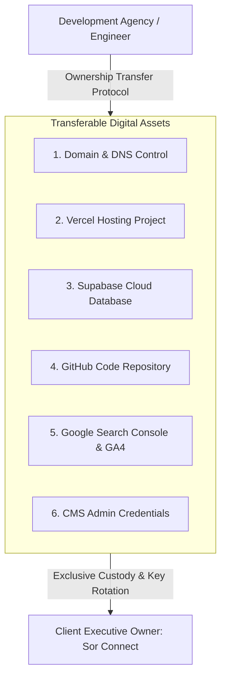

# 18. Ownership Transfer & Handover Protocol

## 1. Handover Overview & Legal Custody

This document establishes the **formal handover protocol** for transferring complete technical, administrative, and legal custody of the Sor Connect web platform from the development team to the **Client Owner (Sor Connect)**.

Following this protocol guarantees that the client has full, unhindered operational control of all digital assets, hosting environments, source code, and customer data with zero lingering third-party dependencies.

---

## 2. Master Asset Transfer Matrix

---

## 3. Step-by-Step Handover Procedures

---

### Phase 1: Domain Name & DNS Registrar Transfer
- **Domain Name:** `sorconnect.in`
- **Registrar:** Hostinger / GoDaddy
- **Handover Procedure:**
  1. Log into domain registrar dashboard.
  2. Navigate to **Account Settings &rarr; Share Access / Change Account Ownership**.
  3. Enter the client's official email address (`info@sorconnect.com` or executive email).
  4. Client accepts the email invitation and confirms primary billing and administrative ownership.
  5. Verify that DNS A-Records (`76.76.21.21`) and CNAME (`cname.vercel-dns.com`) remain intact during transfer.

---

### Phase 2: Vercel Hosting Project Transfer
- **Production URL:** `https://www.sorconnect.in`
- **Handover Procedure:**
  1. In the Vercel Dashboard, navigate to **Project Settings &rarr; General &rarr; Transfer Project**.
  2. Enter the client's Vercel account username or Team ID.
  3. Client accepts the transfer in their Vercel dashboard.
  4. Ensure all custom domains (`www.sorconnect.in` and `sorconnect.in`) remain active with auto-renewing SSL certificates.

---

### Phase 3: Supabase Cloud Database & Storage Transfer
- **Project Reference:** `znjpzipedsowuyrpotgb`
- **Handover Procedure:**
  1. Open [Supabase Dashboard](https://supabase.com/dashboard).
  2. Select project **`sorconnect`** &rarr; navigate to **Project Settings &rarr; Members**.
  3. Click **Invite Member**, enter the client's administrative email, and select role **`Owner`**.
  4. Once the client accepts the invitation, the client can downgrade or remove the developer's email address.
  5. In **Database &rarr; Database Password**, the client should click **Reset Database Password** and securely store the new password in their corporate password manager.

---

### Phase 4: GitHub Source Code Repository Transfer
- **Repository URL:** `https://github.com/coded-dhruv/sorconnect`
- **Handover Procedure:**
  1. In GitHub, navigate to **Settings &rarr; General &rarr; Danger Zone &rarr; Transfer Ownership**.
  2. Enter the client's GitHub username or Corporate Organization handle.
  3. Client accepts the transfer. All commit history, branches, and issue tracking are transferred cleanly.

---

### Phase 5: Google Search Console & Analytics Access
- **Google Search Console Property:** `https://www.sorconnect.in/`
- **Google Analytics 4 Property:** `G-XXXXXXXXXX`
- **Handover Procedure:**
  1. Open Google Search Console &rarr; **Settings &rarr; Users and permissions**.
  2. Click **Add User**, enter the client's Google Account email, and select permission **`Owner`**.
  3. Open Google Analytics &rarr; **Admin &rarr; Property Access Management** &rarr; grant the client **`Administrator`** privileges.

---

## 4. Post-Handover Credential Rotation Checklist

After the client assumes ownership of all accounts, execute the following security rotation:

| System / Account | Action Required | Responsible Party | Status |
|---|---|---|---|
| **Domain Registrar** | Enable 2-Factor Authentication (2FA) and update billing card. | Client Owner | [ ] Pending |
| **Vercel Account** | Enable 2FA on client Vercel account. | Client Owner | [ ] Pending |
| **Supabase Database** | Rotate master PostgreSQL database password. | Client Owner | [ ] Pending |
| **GitHub Repository** | Verify private repository status and review collaborator list. | Client Owner | [ ] Pending |
| **Admin Portal (`/admprtl`)**| Update authorized passwords in `server.js` or environment configuration. | Developer / Client | [ ] Pending |
| **Google Accounts** | Confirm verified ownership in Google Search Console. | Client Owner | [ ] Pending |

---

## 5. Handover Sign-Off & Acknowledgment

By completing the procedures outlined in this manual:
1. The **Client** confirms receipt of all intellectual property, source code, digital assets, database access, and documentation.
2. The **Developer** confirms that no administrative backdoors exist and that full custody has been delivered.
